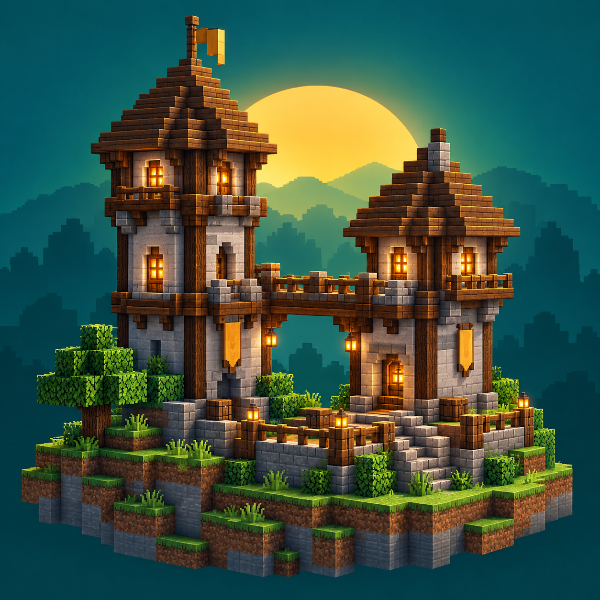

# Colony Horizons



An unofficial **MineColonies compatibility addon** for Minecraft Java **1.21.1 / NeoForge 21.1.250**, with the separately installed **Arcology Horizons** blueprint pack.

[Download alpha.2]( https://github.com/Akamarus/colony-horizons/releases/tag/v0.1.0-alpha.2 ) · [Installation](docs/release/INSTALLATION.md) · [Report an issue](https://github.com/Akamarus/colony-horizons/issues) · [Roadmap](ROADMAP.md)

## Alpha.2 update

Repairs Arcology Mine shaft fluid sealing, supply-raft waterline metadata, and Builder's Hut recall pockets. Install both the addon JAR and matching blueprint ZIP. Existing huts require repair/rebuild to receive blueprint changes. See [alpha.2 notes](docs/release/ALPHA2.md).

## What this alpha does

- Collects supported lanterns before builders remove their support blocks, addressing falling lanterns during upgrades with Amendments.
- Fixes Nether worker resumption, stored-enchantment book handling, plantation shears recognition and animal-home restoration after reload.
- Adds compatibility fixes for Arcology quarry excavation, shaft access and filling materials near fluids.
- Provides a separate pack with **305 blueprints**, repaired existing designs, Stable levels 1–5, Gatehouse levels 1–3, quarry components and ten added plantation fields.

Use MineColonies' own build tool, builders, assignments, requests and upgrades. Normal materials, tools, food and research requirements still apply. This alpha does **not** provide automated outpost founding, a Mayor UI or protected delivery routes.

## Install

Download the addon JAR and separate blueprint ZIP from [Releases](https://github.com/Akamarus/colony-horizons/releases/tag/v0.1.0-alpha.2). Install the JAR in `mods`. Extract the pack into `blueprints` so `blueprints/arcology-horizons/pack.json` exists. Select **Arcology Horizons** using **Switch Pack** in the build tool. The pack is not a resource pack or datapack.

Requires Java 21, Minecraft 1.21.1, NeoForge 21.1.250 and these tested companions:

| Mod | Version |
| --- | --- |
| MineColonies | 1.1.1403-1.21.1 |
| Structurize | 1.0.832-1.21.1-snapshot |
| BlockUI | 1.0.199-1.21.1-snapshot |
| Domum Ornamentum | 1.0.223-snapshot |
| Multi-Piston | 1.2.51-1.21.1-snapshot |

Obtain dependencies from their official distributions. Optional integration was tested with Amendments 2.0.5 and Moonlight 2.23.8. Back up worlds and start with a separate test world. Existing structures are not migrated automatically.

## Verification and limitations

The released JAR passed an official Minecraft Launcher smoke test with the pinned mods and Amendments: new world creation, native Arcology pack selection, building preview, save/reload and clean shutdown. The runtime log had no ERROR/FATAL entries. The source archive rebuilds into a byte-identical JAR. All 95 pack contract checks passed; all 305 blueprints match the previously tested candidate.

Earlier candidate checks covered 49 native scenarios and 44 Python checks. The launcher smoke test did not repeat every scenario. Multiplayer and arbitrary modpacks are not certified. Recovery testing covers clean shutdown, not power loss. See [verification](docs/release/VERIFICATION.md).

## Build the public addon

Use Java 21. Network access is required for the initial Gradle and dependency downloads.

```powershell
.\gradlew.bat publicJar
python tools/Test-PublicRelease.py build/public-libs/colony-horizons-0.1.0-alpha.2.jar
```

On Linux/macOS use `sh gradlew publicJar`. Output is under `build/public-libs`. **Use `publicJar`**, which supplies the release entry point and excludes development QA. This repository is the public release source snapshot; internal development test harnesses are not included. The matching source ZIP accompanies the binary in Releases. See [build instructions](docs/release/PUBLIC-BUILD.md).

## Credits and licensing

**Original Arcology: [BlockyUniverseProductions](https://www.planetminecraft.com/mod/arcology-5819547/).** Arcology Horizons is an unofficial adaptation published with their permission, including future updates. Compatibility repairs and extensions: Akamarus / Colony Horizons.

Addon code is **GPL-3.0-only**; see [LICENSE](LICENSE), [NOTICE](NOTICE), the retained template terms and Gradle notice. The **Arcology pack and original artwork are not GPL** and retain their authors' ownership; see [pack credits](blueprints/arcology-horizons/CREDITS.txt). Author permission to publish this adaptation is not a blanket asset reuse license.

MineColonies, Structurize and companion mods belong to their respective authors. This is not an official LDTTeam or Mojang release. The project icon is original AI-generated promotional artwork; it is not an in-game screenshot.
